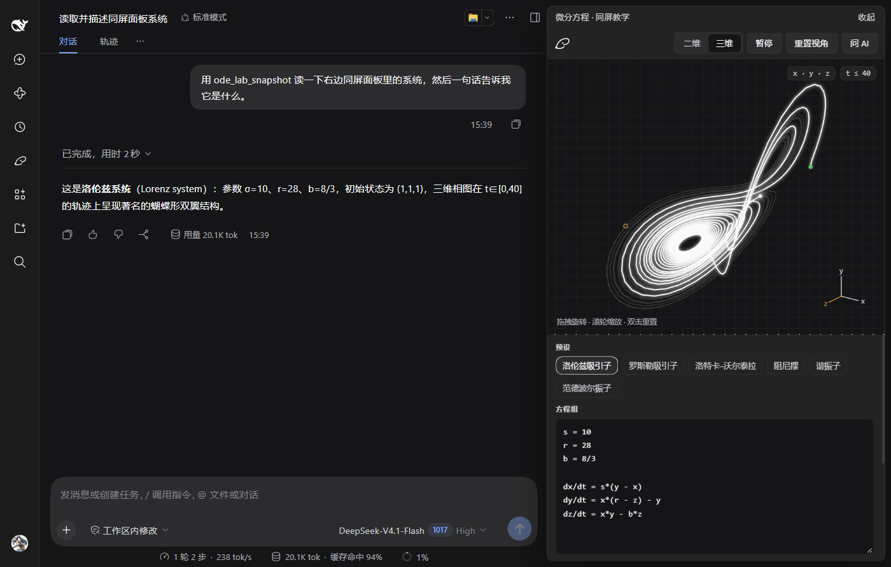
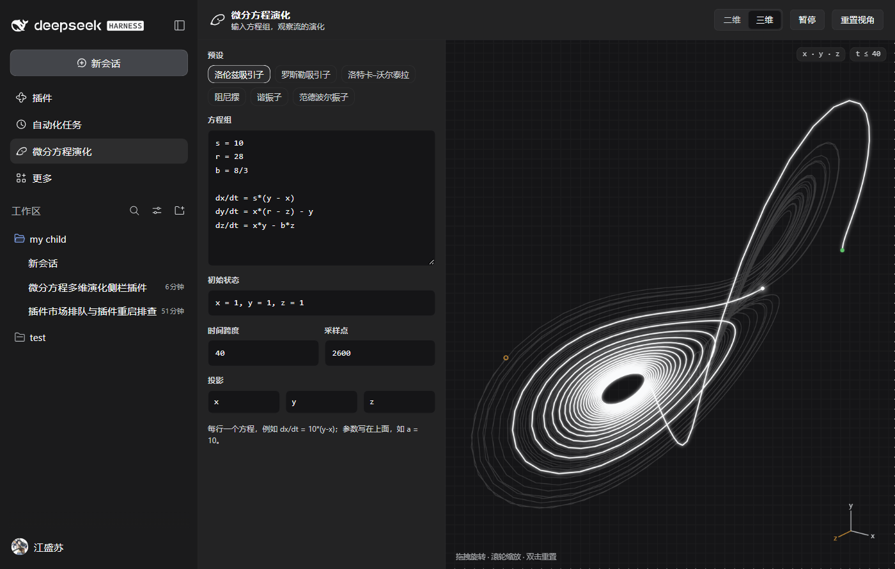
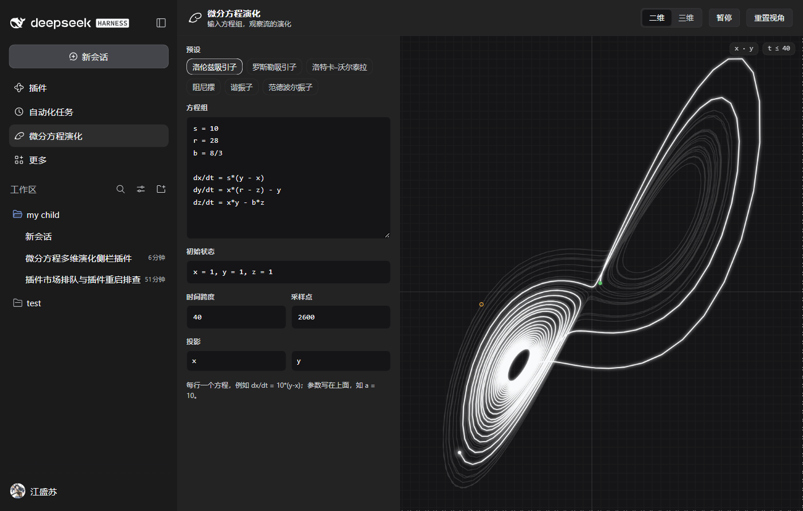
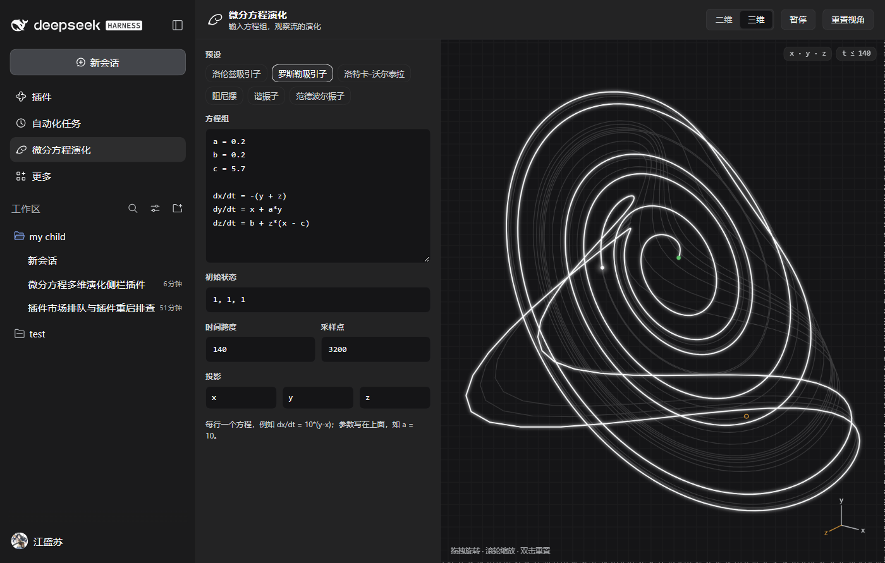
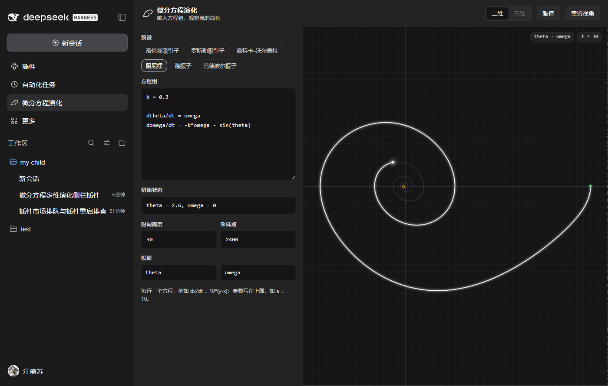
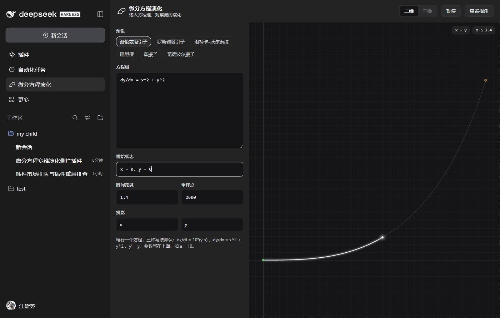
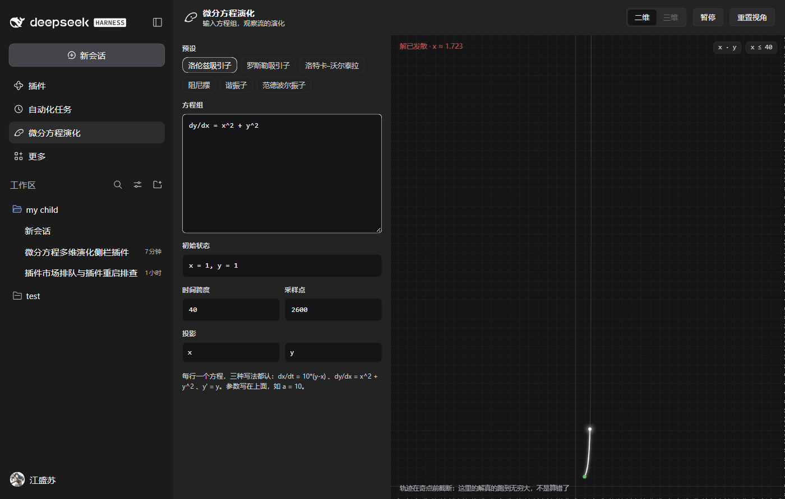
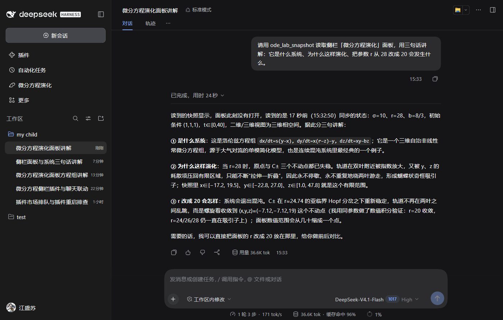

# dsh-ode-lab · 微分方程演化实验室

在 DeepSeek Harness（DSH）的侧栏里输入常微分方程组，实时看它的多维演化：二维相图，或者可以拖拽旋转的三维轨迹。面板还能和聊天窗口同屏、和模型联动——模型读得懂面板此刻在算什么，也能直接改它。



> 左边讲课、右边看图：会话里问一句「读一下面板里的系统」，模型就把当前方程、参数、取值范围读回来讲解。

## 功能

- **输入即演化**：一行一个方程，`dx/dt`、`dy/dx`、`y'` 三种写法都认，参数直接写在方程上方。
- **二维相图 / 三维相空间**：三维轨迹可拖拽旋转、滚轮缩放、双击重置视角；换投影轴只重绘、不重积分。
- **六个内置预设**：洛伦兹、罗斯勒、洛特卡–沃尔泰拉、阻尼摆、谐振子、范德波尔。
- **发散也有解释**：解真的跑到无穷大时（例如 `dy/dx = x² + y²` 在 x≈1.7 的奇点），轨迹在断点处截断并标出位置，而不是画成一条噪声。
- **同屏教学**：右下角一键把方程面板停靠在会话右侧，聊天让出宽度，一边讲一边看图。
- **和模型联动**：三个工具让模型读取/修改面板（见下）。
- **跟随主题**：所有颜色取自 DSH 主题变量，深浅色自动适配；面板内不使用 `eval`，输入什么都不会执行任意代码。

## 截图

Lorenz 吸引子（三维，可旋转）：



同一系统的二维相图：



Rössler 吸引子：



阻尼摆的相轨迹（二维系统自动禁用三维按钮、投影轴只剩 theta/omega）：



莱布尼茨写法 `dy/dx = x^2 + y^2` —— x 自动成为自变量，x–y 图就是解曲线：



发散时截断并注明断点（`解已发散 · x ≈ 1.723`）：



模型读面板后讲解，并明确标注「面板此刻没有打开，读到的是 17 秒前的样子」：



## 安装

插件以 bundle 形式装进 DSH profile（开发期用 link 方式，改动 `client.js` / `index.js` 后需重启桌面端）：

```bash
# 用 DSH 自带的 CLI（profile 名换成你自己的）
dsh plugin add "link:/path/to/dsh-ode-lab"
```

或者在 Harness 里用 `plugin_manager` 的 `install_bundle` 指向本目录。装好后侧栏会出现「微分方程演化」图标。

## 用法

1. 侧栏点「微分方程演化」打开面板（或点右下角「打开方程面板」用同屏模式）。
2. 在「方程组」里写方程，参数写在上面；改「初始状态 / 时间跨度 / 采样点 / 投影」即时重算。

三种写法可以混用，但一份方程组里只能有一个自变量：

```
dy/dx = x^2 + y^2      # 莱布尼茨写法：x 自动成为自变量，x–y 图即解曲线
dx/dt = s*(y - x)      # 牛顿写法
y' = -k*y              # 撇号简写（等价 dy/dt）
```

参数写在方程上面，可被后续表达式引用：

```
s = 10
r = 28
b = 8/3

dx/dt = s*(y - x)
dy/dt = x*(r - z) - y
dz/dt = x*y - b*z
```

换方程组时初始状态会自动对齐到新的变量表（多余的删掉、缺的补 0）。

运算符：`+ - * / ^`、圆括号，函数 `sin cos tan asin acos atan atan2 sinh cosh tanh exp log ln log10 sqrt cbrt abs sign floor ceil round min max pow hypot mod clamp`，常量 `pi tau e phi`。

## 与会话联动

面板和聊天窗口通过一条同源 HTTP 桥（`/ode-lab/*`，只监听本机回环）通信：面板把当前状态报给 Host，模型通过工具读它、改它。

| 工具 | 作用 |
| --- | --- |
| `ode_lab_snapshot` | 读取面板此刻的方程组、初始状态、自变量、积分跨度、视图模式、数值范围、是否发散。面板没打开时读最近一次快照，并注明「N 秒前的样子」。 |
| `ode_lab_set` | 修改方程组 / 初始状态 / 跨度 / 采样点 / 二维三维 / 投影轴。面板在前台约 1.5 秒内生效；没打开时命令保留 5 分钟，打开面板立刻应用。 |
| `ode_lab_presets` | 列出内置预设及其方程。 |

可以直接这样问：

- 「看看侧栏面板里现在是什么系统，讲讲它为什么这样演化」
- 「把参数 c 改成 12，切到二维相图」
- 「这个解会不会发散？面板现在显示到哪一步了」

面板右上角的「问 AI」按钮会把一句现成提问复制到剪贴板，粘贴进聊天即可。

## 实现要点

- **表达式解析**：自写词法 + 递归下降语法分析，编译成闭包，不使用 `eval` / `new Function`。
- **积分**：定步长 RK4，`采样点 × 8` 子步；发散（非有限值或 |y| > 1e9）时提前截断。
- **绘图**：Canvas 2D；三维用 yaw/pitch 正交投影；发散时用中位数绝对偏差裁剪视野，避免爆炸值把轨迹压成一条线。
- **数据**：`Float64Array` 按列存储，投影/换轴只重绘不重积分。
- **联动**：Host 半侧注册 `webServer` 前缀路由和三个工具；客户端 1.5 秒轮询命令、3 秒心跳上报，Host 用 8 秒新鲜度判断面板是否真的在前台。所有注册都包在 try/catch 里——boot manifest 里一个条目抛错会拖垮整个界面。
- **桌面端适配**：浮层面板读取壳层的 `--dsh-frame-top-clearance`，避开 Windows 标题栏悬浮的原生窗口按钮。

## 项目结构

```
client.js              前端：解析器、积分器、绘图、React 面板、槽位注册、桥接轮询
index.js               Host：/ode-lab/* 路由、状态与命令队列、三个 agent 工具
cordis.patch.yml       bundle 的 Cordis 补丁
locale/zh.json, en.json  插件元信息（面板内文案在 client.js 的内联 L10N 里）
icon.svg               侧栏与插件页图标
docs/shots/            README 用的截图
tests/                 自测脚本
```

## 测试

```bash
node tests/test-core.mjs     # 解析、积分、发散、莱布尼茨写法、初始状态对齐
node tests/test-client.mjs   # 模块注册、组件渲染、绘图指令、桥接载荷、布局偏移
node tests/test-host.mjs     # 路由、命令队列、三个工具、鉴权与容错
```

## 已知限制

- 改动 `client.js` / `index.js` 后需要重启 DSH 桌面端才会重新加载。
- 同屏面板展开后，DSH 会把左侧导航收成图标条（宽度不足时的响应式行为），收起面板即恢复。
- 仅支持 `web` 平台客户端；Host 半侧依赖 `webServer` 服务。

## License

MIT
